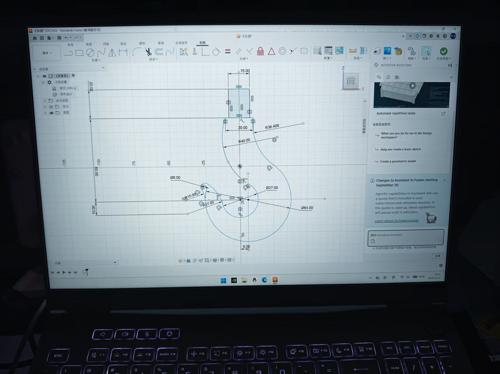
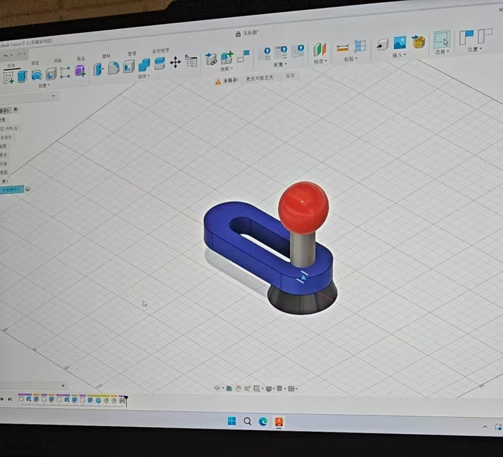
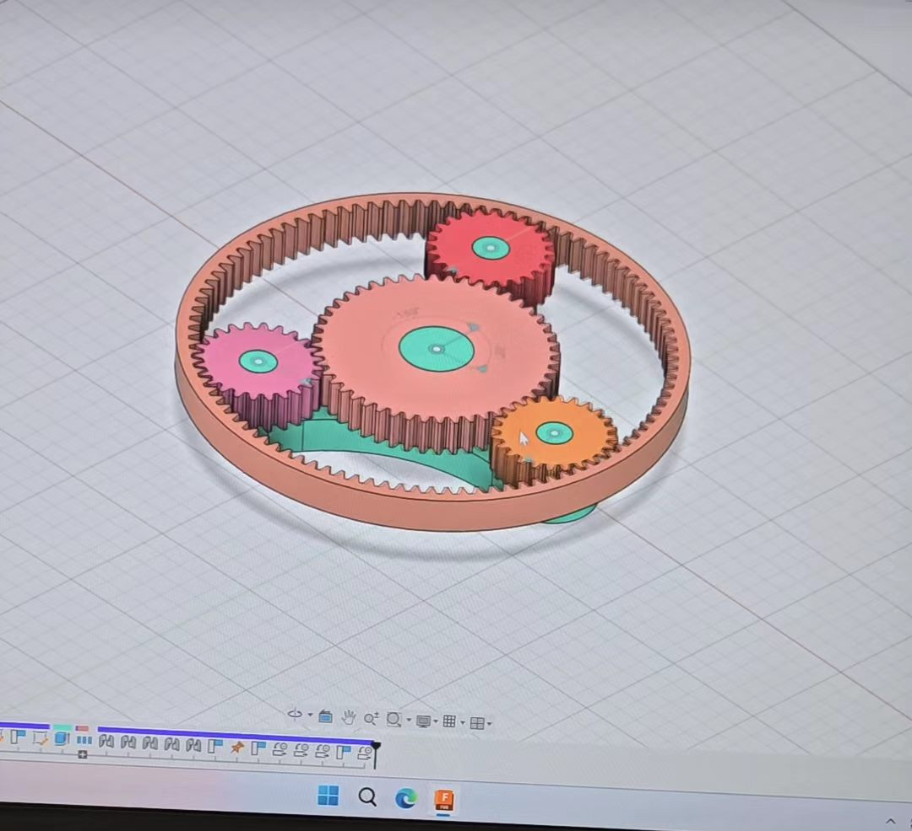
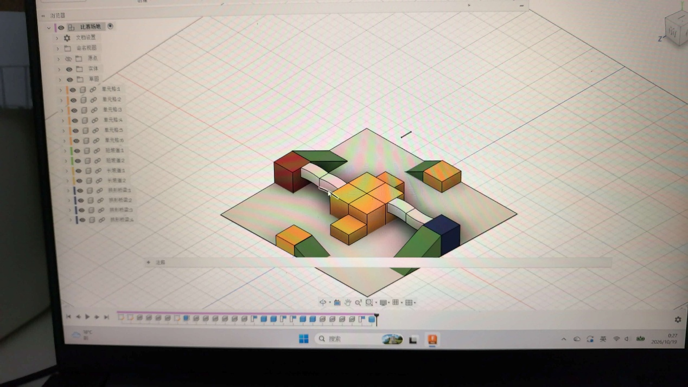
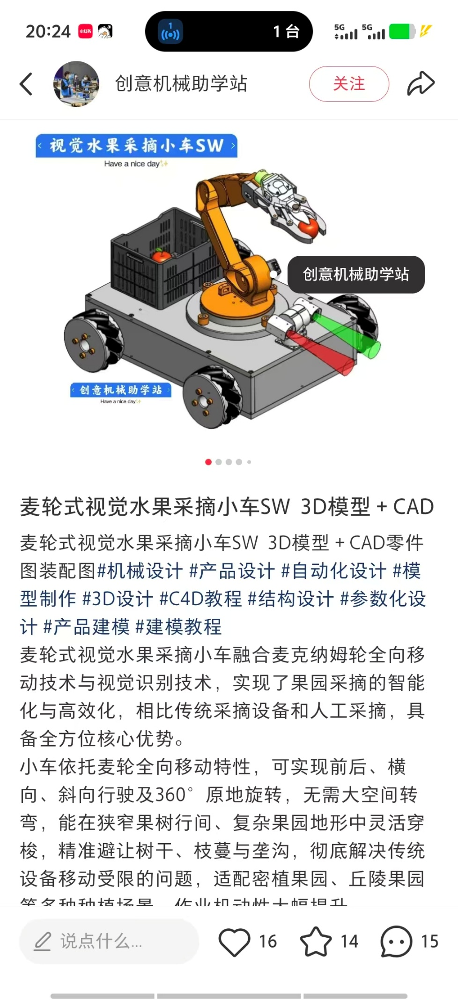
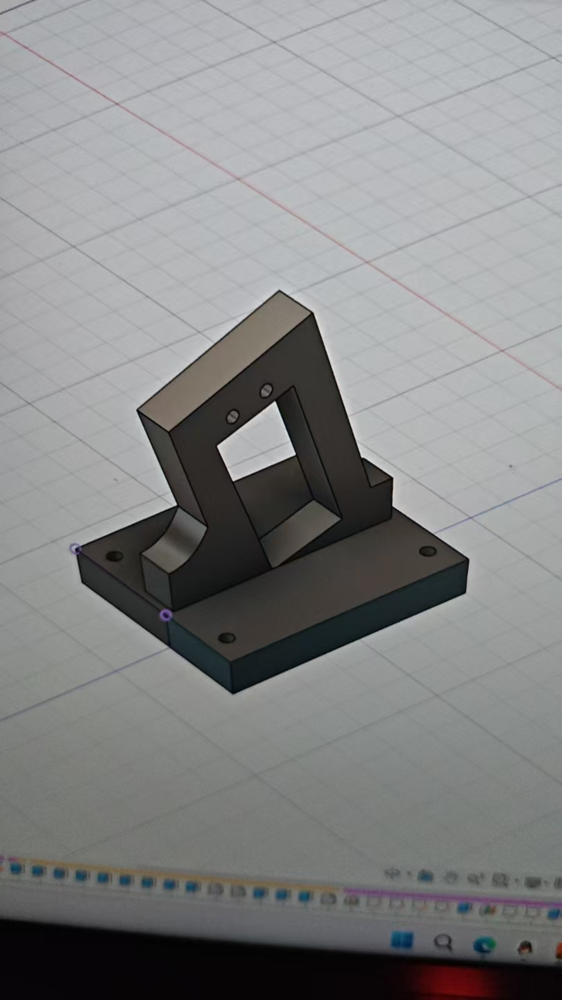
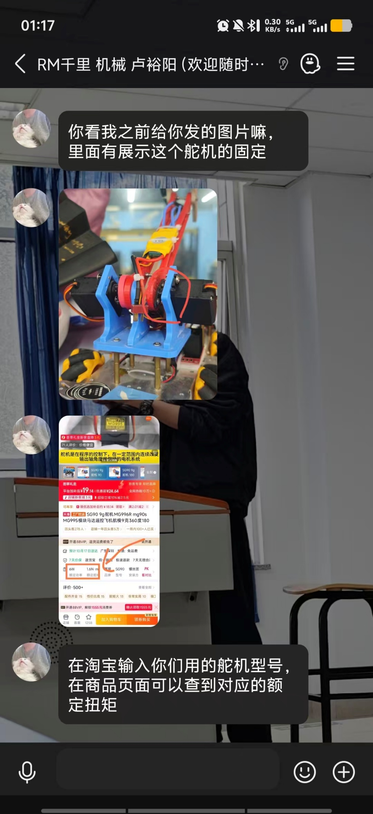

# CRTC 2026 机械组设计日志

本文档按机械组设计进度的时间顺序，记录从赛前技术储备、整车方案确定，到抓取、储存、驱动衔接、车体平台等各项功能结构的设计、迭代与制作过程。每个二级标题对应一项具体功能或结构模块，其正文由“功能描述”与“开发历程”两部分组成，重点说明“为什么这样做”：方案如何取舍、难点在哪里、如何解决，以及目前仍未完成的工作。

| 项目 | 内容 |
| --- | --- |
| 文档类型 | 设计日志（Markdown） |
| 记录对象 | CRTC 2026 参赛机器人（2 台小车）的机械结构 |
| 记录范围 | 9 月 22 日 — 目前（组装阶段，中期考核前） |
| 记录单位 | 机械组（2 人） |
| 内容组织方式 | 板块按设计进度由早到晚排列；同一功能的选型、迭代与结论归入该功能板块内，不按日期切散 |
| 图片来源 | 文中图片均取自机械组设计过程记录（Fusion 360 截屏、聊天记录截屏、模型截图等） |

**板块概览**

| 板块 | 对应功能 / 模块 | 主要时间 | 本板块结论 |
| --- | --- | --- | --- |
| 一 | 赛前技术储备：三维建模与比赛场地复现 | 9 月 22 日 — 10 月 11 日 | 学完 43 集 Fusion 教程，尝试复现比赛场地 |
| 二 | 整车战术定位与总体方案 | 10 月 10 日 | 两车都主动出击，放弃“一守一攻” |
| 三 | 抓取机构：机械臂与机械爪 | 10 月 10 日 — 10 月 15 日 | 机械爪取代钩子与横棍；舵盘 + 法兰式衔接 |
| 四 | 储存与转运机构 | 10 月 10 日 — 10 月 11 日 | 储存仓 + 同平面翻转落料 + 向下挡板防护 |
| 五 | 车体平台与线缆、电池布局 | 10 月 11 日 | 底板与平台之间走线，平台承载机械臂与储存仓 |
| 六 | 关键结构件的轻量化、打印与装配 | 结构攻关之后 — 目前 | 窄厚矩形减重、三角形加固、外协打印、组装中 |
| 七 | 参考资料与说明 | — | 逐项说明外部参考资料与开源使用情况 |

---

## 一、赛前技术储备：三维建模与比赛场地复现

**时间：** 9 月 22 日 — 10 月 11 日

**功能描述**

本板块不直接对应机器人的某一机构，而是设计前的技术储备：机械组需要先具备三维建模与装配能力，后续机械臂、储存仓、平台等结构才有条件被设计和打印出来。本阶段以学习 Fusion 360 为主线，并以比赛场地为载体，完成一次从二维草图到整体模型的完整练习。

**开发历程**

9 月 22 日到 10 月 11 日，机械组跟随 B 站罗大富的 Fusion 教程学习，将 43 集课程全部学完。学习不是只看教程，学完课程内容即动手复现，练习逐步展开：

- 带尺寸约束的二维草图，在草图中标注并锁定各段尺寸（图 1）；
- 零件建模与装配关系，例如行星齿轮组（图 3）、立柱与球体形式的道具模型（图 2）；
- 在课程学完后尝试自己建造比赛场地，把场地与道具逐一建出，形成完整的三维模型（图 4）。

*图 1：Fusion 360 草图练习，二维轮廓已标注 ∅64.00、R36.409、60.00、125 等尺寸（屏幕拍摄）*

*图 2：Fusion 360 建模练习，立柱与球体形式的道具模型*

*图 3：Fusion 360 装配练习，行星齿轮组（含内齿圈、太阳轮与行星轮）*

*图 4：比赛场地复现的整体模型，浏览器树中可见单元 1—6、短桥 1—2、长桥 1—2、桥形构架 1—4 等零件*

**本板块结论**

经过 43 集课程的学习与逐项动手复现，机械组完成了从二维草图、零件建模、装配关系到整场复现的完整练习（图 1—图 4）。这些练习为后续“先建模、再打印、后组装”的工作方式打好了基础：机械臂、储存仓与平台都是先在这套建模能力下做出三维模型，再进入打印与装配环节。

---

## 二、整车战术定位与总体方案

**时间：** 10 月 10 日（战队第 2 次碰头会）

**功能描述**

确定两辆参赛车的外形结构、功能以及每辆车的职责，即回答“两辆车怎么分工、靠什么取胜”，并据此决定整车需要哪些功能模块（抓取、储存、防护、平台等）。

**开发历程**

战队第 2 次碰头会基本确定了两辆车的外形结构和功能，以及每辆车的职责。会上先讨论了两套车型分工思路：

| 方案 | 具体设想 | 出发点 | 主要风险 | 结论 |
| --- | --- | --- | --- | --- |
| A：一守一攻 | 一辆车做得庞大但不设机械臂，专职防守；另一辆轻小、装机械臂，专职进攻 | 以“铤而走险”的方式比赛：妨碍对方小车摄取能量单元与核心，我方小车摄取一个，最终以一比零险胜 | 若进攻小车被妨碍，我方几乎没有其他获取能量单元和核心的方式，风险过大 | 放弃 |
| B：双车主动出击 | 两辆小车都用于主动出击，摄取能量单元和核心 | 两车都具备获取能量单元和核心的能力，不把得分压在一台车上 | —（会上未提出） | 采用 |

会议最终选择方案 B：两辆小车都用于主动出击摄取能量单元和核心。这一决定直接确定了整车的基本形态——两辆车都需要安装取物机构，而不是“一台重防守、一台轻进攻”。

同一次会议上还讨论了取物方式与储存方式，相关方案对比见第三、四板块。

**本板块结论**

车型分工从“一守一攻”改为“双车主动出击”，是本次会议上最重要的决策：A 方案虽然设想精巧，但其得分上限完全依赖进攻小车不被妨碍，一旦被针对就几乎没有补救手段；B 方案牺牲了单车的“专精”，换来了两车都能独立取物的容错空间。

---

## 三、抓取机构：机械臂与机械爪

**时间：** 10 月 10 日方案讨论 — 10 月 15 日结构攻关

**功能描述**

抓取机构负责把地面上的能量单元和能量核心取离地面，并送到本车储存仓。要解决的问题有两个层次：一是末端用什么方式取物（机械爪、钩子还是一根棍）；二是机械臂由什么驱动、又怎样与舵机及车体可靠衔接。

**开发历程**

### 3.1 取物方式选型（10 月 10 日）

开会时讨论机械臂应该按照怎样的方式获取能量方块，当时提出的设想有三种，逐一比较后确定采用机械爪：

| 取物方式 | 具体设想 | 暴露出的问题 | 结论 |
| --- | --- | --- | --- |
| 钩子 | 钩住能量单元和核心的上面边 | 钩子的收放过于费时；考验操作手的灵巧程度 | 放弃 |
| 一根棍横穿 | 用一根棍横穿能量单元和核心的侧边 | 小车行走不便；提出该方案本是为了能同时串起两块甚至多块，但场地中能量单元和核心大多是一个位置一个，且较难以串起；同时还要考虑杠杆原理 | 放弃 |
| 机械爪夹取 | 类似两爪“抓娃娃机”的夹取方式 | —（见下文分析） | 采用 |

三种方案的分歧点其实不在“能不能取到”，而在“取得稳不稳、快不快、操作手承担多少难度”：钩子和横棍都把成败押在操作手的精细动作上，而机械爪把取物动作收敛为一个可控的开合动作。

### 3.2 机械臂建模起步（10 月 11 日）

10 月 11 日，机械组两位成员一开始有些无从下手，无法想象机械臂的运转机理和形式到底是什么样。当晚两人通过网上的视频演示和想象，大致想象出机械臂的构造和运动轨迹，决定用“一个臂”完成抓取和转动，并开始机械臂建模。

通过与队长沟通，我们了解了舵机大概是通过转轴带动机械臂运转的；但此时“舵机如何与机械臂固定、运转如何衔接”依然很模糊，这也成为后面几天攻关的主要问题。

### 3.3 舵机驱动与衔接结构的攻关（10 月 12 日 — 10 月 15 日）

10 月 12 日至 10 月 15 日，机械组开启了漫长且艰辛的探索，两个零基础成员仍不清楚三个关键问题：

1. 机械臂到底怎样与底座连接；
2. 舵机的转轴又到底以怎样的方式驱动机械臂转动；
3. 整个舵机是否需要嵌入机械臂。

为解决这三个问题，我们在 B 站上搜索了大量视频，还试图参考树莓派小车等现有小车方案（图 5）。

*图 5：调研阶段参考的网络小车方案（麦轮式采摘小车，小红书截图）*

期间我们一直向千里战队的机械组学长请教，认知是逐步推进的：

- **先找“标准答案”，行不通。** 我们一开始打算询问学长设计衔接件的“爆炸图”来源参考建模，因为并不清楚衔接件到底是什么样的。学长说，更多的是根据实际需求去推测设计细节；但当时的我们并不清楚到底什么样的结构能够把机械臂与小车衔接，也就不知道应该怎么设计。
- **从实物图里发现法兰。** 好心的学长给我们发了千里战队机械臂衔接的实物图作为参考，于是我们进行了观察探讨。根据实物图我们发现了法兰的存在，对衔接件处有了一点想法。
- **纠正“螺旋桨”的误解。** 一开始我们以为舵机是通过顶端类似于螺旋桨的结构来驱动机械臂转动的；通过请教学长才得知，那个只是一个配件，真正使舵机输出的是动力轴。
- **疑问进一步聚焦。** 此时我们仍然不知道舵机如何驱动机械臂：想不通为何舵机的动力轴只有那么小一点点、怎么能够驱动整个机械臂；驱动处又该怎么连接；是否要在机械臂上造一个锯齿状小孔来嵌入动力轴。
- **从视频里找到舵盘。** 通过搜集到的安装舵机和机械臂的视频，我们了解到了舵盘的存在，并联想到学长所说的“根据实际需求来设计结构”；对比后我们发现，参考实物图里的舵盘与视频里的舵盘有异曲同工之处。

在此基础上我们开始进行自己的构思：参考学长发的实物图，把千里战队复杂高级模型中的**两个舵机改为一个舵机驱动**，并自行建模舵盘来模仿法兰的运作方式。通过舵盘连接舵机和机械臂，并让舵机裸露在空气中：这样既不会因为舵机运作的轻微发烫影响机械臂，又很好地衔接了舵机的动力轴与机械臂，从而设计出更适合我们小车的方案。

*图 6：向千里战队机械组学长请教舵机输出轴与额定扭矩（QQ 聊天记录）*

*图 7：请教法兰件设计与“先明确需求”的设计方法（QQ 聊天记录）*

*图 8：舵机与机械臂的衔接件三维模型*

*图 9：学长提供的舵机固定方式实物参考，以及按舵机型号查询额定扭矩的方法（QQ 聊天记录）*

### 3.4 沟通中确认的两条设计约束

与学长沟通的过程中，除具体做法外还确认了两条约束，它们是后续结构改型的直接依据：

- **重量必须落在舵机额定扭矩范围内。** 舵机有齿轮的那部分是输出轴，要用输出轴连接希望驱动的部分；如果机械臂太重就不行，必须在舵机的额定扭矩范围内。查找方法是按所用舵机型号，在商品页面查对应的额定扭矩。
- **不必纠结零件“叫什么”。** 确实存在法兰这种东西，也可以考虑自己设计一个法兰件；但不必思考它是不是法兰，只需思考这个零件能不能满足需求——比如最先要明确螺丝孔设置在哪、怎么固定。

**本板块结论**

抓取机构从“三种取物方式”收敛到“机械爪”，从“舵机怎么带动机械臂”的困惑收敛到“舵盘 + 法兰式衔接、一台舵机驱动”的方案。方案成立的三个支撑点是：机械爪把取物动作变得可控；舵盘把微小动力轴的输出可靠地接到机械臂上；舵机外露则解决了舵机发烫对机械臂的影响。本板块尚未完成的是与电控组的联调（见第六板块）。

---

## 四、储存与转运机构

**时间：** 10 月 10 日 — 10 月 11 日

**功能描述**

把机械爪取到的能量单元和核心稳定收纳在车内，同时防止对手直接从本车储存仓中把它们夹走。为此需要确定三件事：用什么容器储存、物料从哪里进入容器、容器上部如何防护。

**开发历程**

### 4.1 储存方式：储存仓与拖拉袋

我们考虑过储存仓和拖拉袋两种储存方式。意识到拖拉袋或许会出现不好向内放置的情况，因此选择储存仓。

### 4.2 转运方式的两次否定

机械臂抓到料之后如何进入储存仓，先后提出并否定了两种方案：

| 方案 | 具体设想 | 问题 | 结论 |
| --- | --- | --- | --- |
| 中空管道输送 | 把机械臂做成中空的，以管道的形式与储存仓连在一起，夹取后直接输送进仓 | 对机械爪的灵活度要求过高；夹取后释放时容易掉落 | 舍弃 |
| 后部挡板滑入 | 在储存仓后部设置挡板，让机械臂向后甩，能量单元和核心在挡板上滑至储存仓内 | 不易控制力度；易损坏挡板；也容易扔到外面去 | 舍弃 |
| 同平面翻转落料 | 让机械臂和储存仓位于同一平面，机械臂抓取后翻到后面，把能量单元和核心落至储存仓 | —（最终采用） | 采用 |

两次否定指向同一个问题：把“输送”做得越复杂，对机械爪和操作精度的要求就越高。最终采用的方案把输送动作简化为“抓取—翻转—落料”，机械臂与储存仓在同一平面，靠机械臂自身的翻转完成入仓。

### 4.3 储存仓防护：从向上挡板到向下挡板（10 月 11 日）

在机械臂建模过程中，我们同时考虑到我们的储存仓空间过大，为避免对手直接从我们的储存仓中夹取能量单元和核心，需要在储存仓上部加防护。这一处防护的形式也经历了一次改型：

- **第一版：向上延伸的挡板。** 一开始想到做向上的挡板，但意识到这样会妨碍机械臂释放能量单元和核心。
- **第二版：向下的挡板（采用）。** 改为设置成向下的挡板后，它不仅可以作为防护，也有助于机械臂释放能量单元和核心后它们更容易滑入储存仓，达到“易进难出”的效果。

同一处结构因此同时承担了两个作用：对外阻挡对手夹取，对内引导物料落入。

**本板块结论**

储存与转运机构形成了“储存仓 + 同平面翻转落料 + 向下挡板防护”的完整方案。三条取舍依据是：拖拉袋不好向内放置，所以用储存仓；管道与后挡板输送对精度和力度的要求过高，所以简化为翻转落料；向下挡板既不挡住机械臂的释放动作，又能顺带把落料导向仓内。

---

## 五、车体平台与线缆、电池布局

**时间：** 10 月 11 日

**功能描述**

在车体上为机械臂与储存仓提供安装基面，同时满足队长提出的两项使用需求：隐藏电线、存放电池。

**开发历程**

在队长“隐藏电线、存放电池”的需求下，我们想到了向上延伸出一个平台的做法：在底板和平台之间存放电线和电池，平台上部放机械臂和储存仓。

这一布局实际上同时安排了两件事：

- **机构安装。** 平台上部放置机械臂和储存仓，因此平台同时充当它们的安装基面；
- **收纳。** 电线和电池被收进底板与平台之间的空间，不再外露。

**本板块结论**

平台同时是机械臂与储存仓的安装基面，以及电池、电线的收纳夹层——一个结构承担了安装与收纳两项功能。

---

## 六、关键结构件的轻量化、打印与装配

**时间：** 结构攻关之后 — 目前（中期考核前后）

**功能描述**

把设计转化为可用的实物，并让打印出来的零件同时满足两个要求：够轻（舵机能带动）、够强（能连接运动中的两部分而不轻易损坏）。

**开发历程**

### 6.1 原理补课与分工

在学长的建议下，我们先去了解了扭矩和力矩的概念。了解这些基本概念之后，机械组两人进行分工：一人负责重新改造之前的机械臂，一人负责完善储存仓和平台的建模。

### 6.2 轻量化与加固

在机械组培训中我们了解到：在截面积相同的情况下，窄而厚的矩形比宽而薄的矩形更不容易弯曲。而我们之前建模的机械臂只是一个又厚又重的长方体，于是我们对它进行了削薄轻化处理；同时利用三角形的稳定性，在中间镂空处进行了加固。

这一改型的依据来自两处：截面形状的影响（在截面积相同的前提下，形状决定了抗弯能力）和三角形的稳定性（在减料之后仍需保证刚度）。结合第 3.4 节确认的“重量必须在舵机额定扭矩范围内”，减重是让机械臂能被舵机带动的必要前提，而不是可有可无的优化。

### 6.3 打印渠道与打印工艺约束

由于临近中期考核打印件较多，且打印处有时值班的人没来等原因，我们的平台、储存仓、机械臂并没有打出来，于是我们联系了一家校外的打印店，请其打印这些结构。

与商家沟通的过程中，我们还意识到两件此前没有考虑充分的事情：

- **要按打印机的能力设计结构。** 打印实体还需要考虑打印机打印结构的问题，不能只按理想模型出图；
- **连接运动两部分的部位必须加厚。** 实体结构需要连接运动中的两部分，在某些部位需要进行适当的加厚处理，比如我们中间镂空的三角形结构和衔接处的舵盘都不应该太薄。

### 6.4 当前进度与后续计划

目前我们正在进行组装工作，预计两天内完成；后期继续配合电控组进行修改。

**本板块结论**

从设计到实物的这一环节，实际制约设计的因素并不只有“功能是否实现”，还有“舵机能否带得动”和“打印机能否做得出来”。轻量化（窄厚矩形 + 三角形加固）、关键部位加厚、外协打印，都是为了在这两组约束之间取得平衡。

---

## 七、参考资料与说明

本文档涉及的外部参考资料逐项说明如下：

| 序号 | 参考资料 | 用途 |
| --- | --- | --- |
| 1 | B 站“罗大富”Fusion 360 教程（共 43 集） | 三维建模能力学习（第一板块） |
| 2 | 千里战队机械组学长提供的机械臂衔接实物图、舵机固定方式与额定扭矩查询方法（图 6、图 7、图 9） | 衔接件与舵机固定方案参考（第三板块） |
| 3 | 网络公开的小车与机械臂方案图片（图 5） | 方案调研阶段的参考（第三板块） |
| 4 | 《2026 CRTC 参赛手册 V1.5》 | 比赛场地与规则的依据（第一板块场地复现） |

**关于开源项目的说明：** 本文档所记录的机械组结构设计与制作过程中，未使用开源项目或开源代码；如后续在机器人制作或代码编写中引入开源项目，将按参赛手册要求在本节完整说明其名称、来源、版本与使用范围。

**关于图片的说明：** 文中图片均为机械组设计过程记录，包括 Fusion 360 界面截屏、与学长的聊天记录截屏以及模型截图，未作修改或合成。

## 八、现存结构问题汇总

1. 旧版仓体与底盘无法紧密连接，仓体和二层平面之间连接不稳定，原有设计方案作废，需要重新设计。

2. 零件预留孔缺失，装配时缺少螺丝安装位，不能直接用标准螺丝螺母紧固。

3. 二层平面没有预留走线窗口，底层杜邦线无法穿过二层平面连接机械臂。

4. 二层平面高度偏低，机械臂作业高度受限，抓取高度不足，只能抓取高处方块。

5. 机械臂存在角度限制矛盾，双段机械臂作业范围不足，抓取目标方块存在盲区。

6. 整机稳定性较差，当前结构容易晃动，之前临时依靠透明胶固定，可靠性差。

7. 电池仓结构需要重新设计。

新版改进方案

1. 固定方案：使用6根螺柱 + 一块3mm二层平面作为支撑结构，仓体后置安装，结构轻便。

2. 设计要求：建模完成后，在Fusion360内先做虚拟拼装测试，优先保证螺丝、螺母可顺利装配紧固。

3. 二层板加高1cm，并且开出走线窗口，方便底层电路线材向上引出。

4. 双段机械臂每段臂长适当缩短，优化转动角度，解决抓取高度、角度限制问题；机械臂、机械爪直接打印现成装配模型，分零件打印。

5. 零件打印完成后，无预留孔位的接触面用粘接方式装配。

任务分工

- 机械组：完成仓体、电池仓、二层平面的新结构建模，在软件内预装配检查干涉与孔位。

- 电气组：负责机械臂模型导出、小车电控调试，完成两车协同运动（进阶功能）。

备注

- 本次测试暴露出：仅依靠想象做设计会出现装配漏洞，结构设计必须提前模拟装配。
- 模型文件为多零部件装配体，后续拆分成单个零件打印。

---
